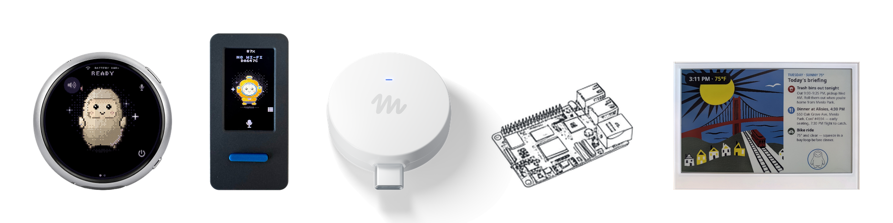

<!--
Copyright (c) Meta Platforms, Inc. and affiliates.

Licensed under the Apache License, Version 2.0 (the "License");
you may not use this file except in compliance with the License.
You may obtain a copy of the License at

    http://www.apache.org/licenses/LICENSE-2.0

Unless required by applicable law or agreed to in writing, software
distributed under the License is distributed on an "AS IS" BASIS,
WITHOUT WARRANTIES OR CONDITIONS OF ANY KIND, either express or implied.
See the License for the specific language governing permissions and
limitations under the License.
-->

# AI Passport Muse

This is a fork of [facebookincubator/muse-gadget-sdk](https://github.com/facebookincubator/muse-gadget-sdk); the default `passport-port` branch builds Muse firmware for the **FoloToy AI Passport**. The board is an ESP32-C3: 400 KB of SRAM, no PSRAM, 8 MB of flash, a 240×320 ST7789 panel, ES8311 audio, and three ADC keys. Hold OK to talk; the reply appears on screen and is also spoken through the speaker — speech is synthesised on a Raspberry Pi in the same LAN, and the board never decodes audio itself.

[中文](README.md)

The license is Apache-2.0, see [`LICENSE`](LICENSE). Third-party files from upstream keep their original licenses; the Jollybot avatar is not covered by Apache-2.0. Flashing a custom firmware can brick the board and may void the warranty.

Pin-level notes and memory measurements are in [`esp32/devices/passport.md`](esp32/devices/passport.md).

<p align="center">
  <a href="https://x.com/cgnot996"></a>
  
</p>

<p align="center">
  <a href="https://x.com/cgnot996">Follow @cgnot996 on X</a>
  ·
  On WeChat, search 铁柱AGI or scan the code for the official account
</p>

<p align="center">
  
</p>

## New in this fork: spoken replies (2026-11)

Upstream shows the reply as a text caption only. This fork makes it audible by moving the decoding off the board entirely.

What happens on one reply:

1. When a turn finishes, `muse_voice.c` takes the full reply text (`muse_hatch_turn_reply_text()`, implemented in `muse_chat_link.c`).
2. The device `POST`s the plain text to `CONFIG_MUSE_TTS_PCM_URL`, default `http://192.168.1.10:8020/tts-pcm`, with `Content-Type: text/plain`. The response is raw **16 kHz, mono, s16le** PCM.
3. On the server, `edge-tts` synthesises an MP3 and `ffmpeg` converts it to a PCM stream (the script lives in [`server/`](server/)).
4. The firmware plays as it receives: in the HTTP event callback it fills a `MUSE_AUDIO_CHUNK` buffer (320 frames, 20 ms) and calls `muse_audio_write()` into I2S. Nothing is written to flash and the whole reply is never buffered. The HTTP timeout is 120 seconds.

**Why MP3 is not decoded on the board.** The first version fed the returned MP3 to the bundled `minimp3`. On hardware it tripped the stack-protection panic: the decoder's scratch stack was larger than the voice task's stack, and the C3's 400 KB of SRAM cannot provide a bigger one. With the server producing PCM, the board only receives bytes, packs samples and writes I2S; the stack holds a single 320-frame output buffer.

**Measured result.** After pairing and setup completed, voice chat and spoken replies both worked end to end, and the serial log recorded a single **22.54-second** TTS playback.

The cost is explicit: if the server is offline or not on the same LAN as the board, that reply is text only; and the server truncates TTS text beyond 2000 characters.

## Hardware

| Item | Specification |
|---|---|
| MCU | ESP32-C3, single-core RISC-V, up to 160 MHz |
| Memory | 400 KB SRAM, no PSRAM |
| Flash | 8 MB (XMC, DIO, 80 MHz) |
| Display | 240×320 ST7789P3 over SPI, 30 px corner mask |
| Buttons | Three-key ADC ladder (GPIO0, UP / DOWN / OK, external 10 kΩ pull-up) |
| Audio | ES8311 codec, I2S master, 16 kHz / 16 bit, speaker and microphone |
| Battery | CW2017 gauge, 520 mAh |
| Radio | Wi-Fi 2.4 GHz and BLE 5 |
| Port | USB, native USB Serial/JTAG (GPIO18/19) |

## Build and flash

### Prepare

- A FoloToy AI Passport and a USB cable that carries data.
- macOS or Linux.
- [ESP-IDF v6.0.1](https://docs.espressif.com/projects/esp-idf/en/v6.0.1/esp32c3/get-started/index.html) with the `esp32c3` tools. Other versions are untested.
- An SDK token from your Muse account: [gadgets.muse.ai](https://gadgets.muse.ai/settings/sdk-tokens) (Account > SDK tokens). Read the [Gadget SDK Terms](https://gadgets.muse.ai/sdk-terms) first.
- The Muse app on your phone. During pairing, enable Settings > Devices > Developer mode.

Install the toolchain:

```sh
git clone -b v6.0.1 --recursive https://github.com/espressif/esp-idf.git ~/esp/esp-idf-v6
~/esp/esp-idf-v6/install.sh esp32c3
. ~/esp/esp-idf-v6/export.sh
```

Run `export.sh` again in every new shell.

Get the code:

```sh
git clone https://github.com/haoinvest-cpu/ai-passport-muse.git
cd ai-passport-muse
```

### Build

Put your token in `esp32/build-passport/sdkconfig.local`. That directory is gitignored. Never write the token, the Wi-Fi SSID or the Wi-Fi password into `devices/sdkconfig.muse-passport` or any other tracked file.

```sh
mkdir -p esp32/build-passport
cat > esp32/build-passport/sdkconfig.local << 'EOF'
CONFIG_GADGET_SDK_TOKEN="mgst_paste_your_token_here"
EOF
```

The TTS server address is easiest to set in the same file (the next section covers running the server). Writing it to `sdkconfig.local` overrides the board default without touching a tracked file:

```sh
cat >> esp32/build-passport/sdkconfig.local << 'EOF'
CONFIG_MUSE_TTS_PCM_URL="http://192.168.1.10:8020/tts-pcm"
EOF
```

The `192.168.1.10` line in `devices/sdkconfig.muse-passport` is only an example, not a reachable host.

Whether the LAN can reach Muse directly decides whether you need a proxy. These variables are read on every build and are not stored in git. Do not put an account or password in them.

1. A soft router already does transparent proxying. Do not set `MUSE_HTTP_PROXY_HOST`. The firmware connects directly and the router forwards the traffic.
2. No transparent proxy. Pick a LAN machine that runs a proxy accepting other clients (for example Clash with Allow LAN enabled) and use its IPv4 address and port. Hostnames do not work. The port defaults to 7890 when omitted.

```sh
cd esp32
. ~/esp/esp-idf-v6/export.sh
export MUSE_HTTP_PROXY_HOST=192.168.1.10
export MUSE_HTTP_PROXY_PORT=7890
idf.py -B build-passport -DIDF_TARGET=esp32c3 \
  -DSDKCONFIG=build-passport/sdkconfig \
  -DSDKCONFIG_DEFAULTS="sdkconfig.defaults;devices/sdkconfig.muse;devices/sdkconfig.muse-passport;build-passport/sdkconfig.local" \
  build
```

Soft-router users drop the two `export` lines. Build without `MUSE_HTTP_PROXY_HOST` and you get a direct-connection image. With a proxy, the firmware sends an HTTP CONNECT to that machine and then does TLS; the proxy sees the hostname but not the request body.

Do not build `build-passport` with `tools/muse/board.sh build`; that script deletes `managed_components`.

### Flash

Make sure every button is released first. GPIO0 is both the key ladder and the boot strap; holding it during reset enters download mode. Find the port: `ls /dev/cu.usb*` on macOS, `ls /dev/ttyACM*` on Linux.

```sh
cd esp32/build-passport
python -m esptool --chip esp32c3 -p /dev/cu.usbmodem1101 -b 460800 \
  --before default-reset --after hard-reset \
  write-flash @flash_args
```

Use the port on your machine. `flash_args` already sets `dio`, 80 MHz, `--flash-size keep`, and these offsets: bootloader `0x0`, partition table `0x10000`, OTA data `0x1d000`, application `0x20000`. Every segment must print `Hash of data verified`.

Do not use `idf.py flash`. ESP-IDF 6.0.1 splits `SERIAL_TOOL`, and that command is unreliable here. Do not add `--erase-all` and do not run `idf.py erase-flash`: that wipes pairing, Wi-Fi and display settings from NVS. A normal upgrade only overwrites the four segments above, leaving pairing in place.

Opening the serial port often resets the board. Do not open it during pairing. To watch the log afterwards:

```sh
. ~/esp/esp-idf-v6/export.sh
cd esp32
idf.py -p /dev/cu.usbmodem1101 -B build-passport monitor
```

Quit with `Ctrl-]`.

## Server deployment

The firmware only plays audio; synthesis happens on another machine. The server needs Python 3 and `ffmpeg`; the only Python dependencies are `edge-tts` and `aiohttp`:

```sh
sudo apt install ffmpeg python3 python3-venv
cd server
python3 -m venv .venv
. .venv/bin/activate
pip install -r requirements.txt
MUSE_TTS_VOICE=zh-CN-XiaoxiaoNeural PORT=8020 python3 muse-tts-server.py
```

- `MUSE_TTS_KEY` is optional: when set, requests must carry `X-Key`; when empty, no check is made.
- `MUSE_TTS_VOICE` defaults to `en-US-AriaNeural`; use `zh-CN-XiaoxiaoNeural` for Chinese replies.
- `PORT` defaults to 8020 and the script binds `0.0.0.0`.

Two endpoints: `POST /tts` returns MP3, `POST /tts-pcm` returns 16 kHz mono s16le PCM (the firmware uses this one). The request body is plain text. Details and `curl` smoke tests are in [`server/README.md`](server/README.md).

The server and the board must be on the same mutually reachable subnet with TCP 8020 open; then put its address in `CONFIG_MUSE_TTS_PCM_URL` and rebuild and reflash.

## First use

A device that has been paired before rejoins its old Wi-Fi after flashing. Add a new device in the Muse app; its name is `MuseGadget-` plus a few characters. When the screen asks for confirmation, press OK once.

- Hold OK to record, release to send. Wait until the reply is on screen (and has finished speaking) before pressing again.
- On the home screen, a short UP opens the menu and a short DOWN shows the previous reply. Inside the menu, UP and DOWN move and OK confirms.
- Unpair only through the menu item Reset pairing. This board has no "hold for 5 seconds to factory reset" gesture.

## Pitfalls (so you don't repeat them)

1. **Decoding MP3 on the board blows the stack.** The first version ran `minimp3` in the voice task on the MP3 returned by the server, and on hardware it immediately hit the stack-protection panic: the decoder's scratch stack was bigger than the task's stack, and there is no spare memory for another decode task on the C3. The MP3-to-PCM conversion now happens on the server (`ffmpeg -ac 1 -ar 16000 -f s16le`), and the board feeds I2S 20 ms at a time. Do not add a decoder back on the board.
2. **The C3 has no PSRAM, so both stack and heap are tight.** The 400 KB of SRAM has to hold Wi-Fi, BLE, LVGL, I2S DMA and TLS at once. Measured internal heap bottomed out around 27 KB with a largest free block of about 22 KB; the main task stack needs 12288 bytes to survive a TLS handshake through a proxy; I2S runs only 4 descriptors × 160 frames (about 40 ms of buffer) because anything deeper misses the 24 KiB headroom line. Do not buffer a whole reply on the playback path, and do not grow the stack or buffers.
3. **The TTS server must be on the same LAN as the board, and its address lives in sdkconfig.** The address is `CONFIG_MUSE_TTS_PCM_URL`; the default in the repo is an example, so it will not connect until you change it. When it cannot connect, that reply is text only and the screen shows no error. If the server changes IP, rebuild and reflash; the firmware has no runtime configuration.
4. **Do not use `idf.py flash`, and never `erase-all`.** ESP-IDF 6.0.1's `SERIAL_TOOL` split makes the former unreliable; the latter wipes pairing, Wi-Fi and display settings from NVS, forcing you to set up the network and pair again. Use `esptool ... write-flash @flash_args`.
5. **Keep the serial port closed while pairing.** Opening it often resets the board and interrupts pairing; GPIO0 is also the boot strap, so confirm all three keys are released before flashing.

## Notes

- Pair only on a network you trust. This is community firmware with no vendor certificate during pairing, so it cannot stop a man-in-the-middle on the same network.
- The token, Wi-Fi password and proxy address stay in your local `build-passport/` or the current shell's environment. The TTS `MUSE_TTS_KEY` is the same: never put it in a file you commit.
- `MUSE_HTTP_PROXY_HOST` is read on every build. To switch between direct and proxied builds, change the environment and rebuild and reflash.
- There is no PSRAM. Speech is synthesised on the server and the board only plays PCM; when the server is unreachable the reply falls back to text.
- Do not change the partition table or the four flash offsets. Factory recovery needs a full backup you saved yourself, written back from `0x0` without changing its layout.
- If flashing fails, release the buttons and retry. If it still will not connect, hold the buttons, tap reset, then release, to enter download mode.

## Upstream: Muse Gadgets

<p align="center">
  <picture>
    <source media="(prefers-color-scheme: dark)" srcset=".github/images/muse-gadgets-dark.png">
    
  </picture>
</p>

Muse gadgets are open source devices you build yourself. Program an
off-the-shelf ESP32 board or set up a Raspberry Pi with our device SDKs, then
connect Muse to your displays, buttons, sensors, actuators, and whatever else
you've got lying on your workbench.

We open sourced the SDKs and firmware here. It's built by hackers, for hackers,
just for fun. Side effects of tinkering may include bricked boards, voided
warranties, brownouts, or bankruptcies. Proceed at your own risk!

| | |
|---|---|
| [**ESP32 Device SDK**](esp32) | Connect your ESP32 board to Muse through our open source SDK. Throw in a screen to show images, add audio in and out, or wire up other sensors. |
| [**Linux Device SDK**](linux) | Turn that spare Raspberry Pi or Linux box into a Muse gadget. Hack in your own commands to let Muse handle sysadmin chores or your Home Assistant setup. |

Before you flash or pair a gadget, get an
[SDK token](https://gadgets.muse.ai/settings/sdk-tokens) and review the
[Gadget SDK Terms](https://gadgets.muse.ai/sdk-terms). Every gadget needs a
token to pair.

ESP32 and Linux gadgets pair with the Muse app on iOS and Android, via
Settings > Devices. Turn on Developer mode there first, then look for devices
prefixed with "MuseGadget".
Each directory has a `README.md` to get started and an `AGENTS.md` for coding
agents like [Muse Code](https://developer.meta.com/ai/lp/muse-code/).

The two upstreams of this repo are the port [RongleCat/ai-passport-muse](https://github.com/RongleCat/ai-passport-muse) and the SDK it builds on, [facebookincubator/muse-gadget-sdk](https://github.com/facebookincubator/muse-gadget-sdk). The license stays Apache-2.0, as upstream.

## Community

Meet other hackers who are building and customizing Muse gadgets in our
community [Discord](https://discord.gg/3bhjCkZdd6). Get inspired, support each
other, and share what you make.

## License

Muse Gadgets is licensed under the Apache License, Version 2.0, found in
[`LICENSE`](LICENSE), except for these third-party files, which keep their
upstream licenses:

| Path | Upstream | License |
|---|---|---|
| [`esp32/components/minimp3/include/minimp3.h`](esp32/components/minimp3) | [lieff/minimp3](https://github.com/lieff/minimp3) | CC0-1.0, see [`LICENSE`](esp32/components/minimp3/LICENSE) |
| [`esp32/main/pixel_font.c`](esp32/main/pixel_font.c) | Adafruit GFX `glcdfont.c` | BSD-2-Clause, in the file header |

Dependencies fetched at build time are under their own licenses: ESP-IDF
components (into `esp32/managed_components/`), and the simulator's LVGL and
SDL (listed in [`esp32/simulator/THIRD_PARTY.md`](esp32/simulator/THIRD_PARTY.md)).

The Apache License does not cover the [Jollybot avatar](esp32/avatar).
