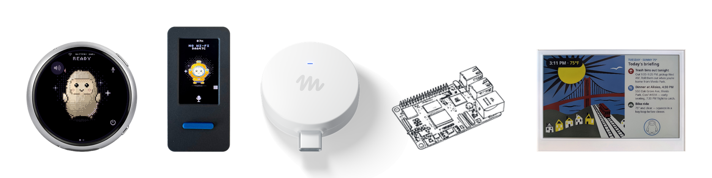

<!--
Copyright (c) Meta Platforms, Inc. and affiliates.

Licensed under the Apache License, Version 2.0 (the "License");
you may not use this file except in compliance with the License.
You may obtain a copy of the License at

    http://www.apache.org/licenses/LICENSE-2.0

Unless required by applicable law or agreed to in writing, software
distributed under the License is distributed on an "AS IS" BASIS,
WITHOUT WARRANTIES OR CONDITIONS OF ANY KIND, either express or implied.
See the License for the specific language governing permissions and
limitations under the License.
-->

# AI Passport Muse

这是 [facebookincubator/muse-gadget-sdk](https://github.com/facebookincubator/muse-gadget-sdk) 的分支，默认分支 `passport-port` 用来给 **FoloToy AI Passport** 编译 Muse 固件。板子是 ESP32-C3：400 KB SRAM、没有 PSRAM、8 MB 闪存、240×320 的 ST7789 屏、ES8311 音频、三个 ADC 按键。按住 OK 说话，回复显示在屏幕上，并且会从扬声器念出来——语音在局域网里一台树莓派上合成，板子自己不解码音频。

[English](README.en.md)

许可证是 Apache-2.0，见 [`LICENSE`](LICENSE)。上游的第三方文件仍用它们原来的许可证，Jollybot 头像不在 Apache-2.0 之内。刷入自制固件可能变砖，也可能影响保修。

板级引脚和内存测量在 [`esp32/devices/passport.md`](esp32/devices/passport.md)。

<p align="center">
  <a href="https://x.com/cgnot996"></a>
  
</p>

<p align="center">
  <a href="https://x.com/cgnot996">关注 X @cgnot996</a>
  ·
  微信搜一搜「铁柱AGI」，或扫下面的码关注公众号
</p>

<p align="center">
  
</p>

## 本 fork 新增：语音播报（2026-11）

原来的固件只有文字字幕。这次改动让回复出声，做法是把解码整个挪到板子外面。

一次播报的流程：

1. 一轮对话结束，`muse_voice.c` 拿到这一轮的完整回复文本（`muse_hatch_turn_reply_text()`，实现在 `muse_chat_link.c`）。
2. 设备以 `POST` 把纯文本发给 `CONFIG_MUSE_TTS_PCM_URL`，默认 `http://192.168.1.10:8020/tts-pcm`，`Content-Type: text/plain`。返回的是一段 **16 kHz、单声道、s16le** 的裸 PCM。
3. 服务器那侧用 `edge-tts` 合成 MP3，再用 `ffmpeg` 转成 PCM 流回来（脚本在 [`server/`](server/)）。
4. 固件在 HTTP 的事件回调里边收边播：每攒够 `MUSE_AUDIO_CHUNK`（320 帧，20 ms）就 `muse_audio_write()` 写进 I2S，不落盘、不整段缓存。HTTP 超时给了 120 秒。

**为什么不在板上解 MP3。** 首版是把服务器返回的 MP3 交给树里的 `minimp3` 解码。实测跑起来会触发栈保护重启——解码用的临时栈超过了语音任务可用的栈，C3 的 400 KB SRAM 又拿不出更大的栈。改成服务器出 PCM 之后，板子只剩“收字节、拼样本、写 I2S”这一条路径，栈上只有一个 320 帧的输出缓冲。

**实测结果。** 配对和 setup 走完之后，语音对话加语音播报全通，串口日志里记录到一条连播 **22.54 秒** 的 TTS 音频。

代价也说清楚：服务器不在线、或板子和服务器不在同一个局域网，这条回复就只有字幕没有声音；TTS 文本超过 2000 字符会被服务器截断。

## 硬件

| 项目 | 规格 |
|---|---|
| 主控 | ESP32-C3，单核 RISC-V，最高 160 MHz |
| 内存 | 400 KB SRAM，无 PSRAM |
| 闪存 | 8 MB（XMC，DIO，80 MHz） |
| 屏幕 | 240×320 ST7789P3，SPI，30 px 圆角遮罩 |
| 按键 | 三键 ADC 按键梯（GPIO0，UP / DOWN / OK，外置 10 kΩ 上拉） |
| 音频 | ES8311 codec，I2S 主模式，16 kHz / 16 bit，扬声器 + 麦克风 |
| 电池 | CW2017 电量计，520 mAh |
| 无线 | Wi-Fi 2.4 GHz + BLE 5 |
| 接口 | USB，原生 USB Serial/JTAG（GPIO18/19） |

## 构建与烧录

### 准备

- 一块 FoloToy AI Passport，以及一根能传数据的 USB 线。
- macOS 或 Linux。
- [ESP-IDF v6.0.1](https://docs.espressif.com/projects/esp-idf/en/v6.0.1/esp32c3/get-started/index.html)，并且安装 `esp32c3` 工具链。其他版本没有验证过。
- Muse 账号里的 SDK token：[gadgets.muse.ai](https://gadgets.muse.ai/settings/sdk-tokens)（Account > SDK tokens）。使用前阅读 [Gadget SDK Terms](https://gadgets.muse.ai/sdk-terms)。
- 手机上的 Muse App。配对时打开 Settings > Devices > Developer mode。

安装工具链：

```sh
git clone -b v6.0.1 --recursive https://github.com/espressif/esp-idf.git ~/esp/esp-idf-v6
~/esp/esp-idf-v6/install.sh esp32c3
. ~/esp/esp-idf-v6/export.sh
```

每开一个新终端都要再执行一次 `export.sh`。

拉下这份代码：

```sh
git clone https://github.com/haoinvest-cpu/ai-passport-muse.git
cd ai-passport-muse
```

### 编译

在 `esp32/build-passport/sdkconfig.local` 里写你自己的 token。这个目录被 git 忽略。不要把 token、Wi-Fi 名称、Wi-Fi 密码写进 `devices/sdkconfig.muse-passport` 或任何会提交的文件。

```sh
mkdir -p esp32/build-passport
cat > esp32/build-passport/sdkconfig.local << 'EOF'
CONFIG_GADGET_SDK_TOKEN="mgst_把你的 token 贴在这里"
EOF
```

语音播报的服务器地址也在这里改最省事（下一节讲服务器怎么跑）。写进 `sdkconfig.local` 会覆盖板级默认值，不用动仓库里的文件：

```sh
cat >> esp32/build-passport/sdkconfig.local << 'EOF'
CONFIG_MUSE_TTS_PCM_URL="http://192.168.1.10:8020/tts-pcm"
EOF
```

`devices/sdkconfig.muse-passport` 里那行 `192.168.1.10` 只是示例地址，不是能直接用的主机。

局域网能不能直接到达 Muse，决定要不要设置代理。这两个变量在每次编译时读取，不会写进仓库。不要在里面放账号或密码。

1. 软路由已经做了透明代理。不要设置 `MUSE_HTTP_PROXY_HOST`。固件直连，流量由软路由转发。
2. 没有透明代理。找一台局域网里已经开着代理、并且允许其他设备使用的机器（例如打开了 Allow LAN 的 Clash），写它的 IPv4 地址和端口。不支持域名。端口省略时默认 7890。

```sh
cd esp32
. ~/esp/esp-idf-v6/export.sh
export MUSE_HTTP_PROXY_HOST=192.168.1.10
export MUSE_HTTP_PROXY_PORT=7890
idf.py -B build-passport -DIDF_TARGET=esp32c3 \
  -DSDKCONFIG=build-passport/sdkconfig \
  -DSDKCONFIG_DEFAULTS="sdkconfig.defaults;devices/sdkconfig.muse;devices/sdkconfig.muse-passport;build-passport/sdkconfig.local" \
  build
```

软路由用户删掉两行 `export`。漏设 `MUSE_HTTP_PROXY_HOST` 再编译，得到的是直连固件。代理开着时，固件先向这台机器发 HTTP CONNECT，再做 TLS。代理看得到目标主机名，看不到请求正文。

不要用 `tools/muse/board.sh build` 来编这个 `build-passport` 目录。那个脚本会删掉 `managed_components`。

### 刷入

先确认按键都松开。GPIO0 既是三个按键，也是芯片的启动脚，复位时按住会进入下载模式。查端口：macOS 用 `ls /dev/cu.usb*`，Linux 用 `ls /dev/ttyACM*`。

```sh
cd esp32/build-passport
python -m esptool --chip esp32c3 -p /dev/cu.usbmodem1101 -b 460800 \
  --before default-reset --after hard-reset \
  write-flash @flash_args
```

把端口换成你机器上的那个。`flash_args` 里已经是 `dio`、80 MHz、`--flash-size keep`，以及这些地址：bootloader `0x0`，分区表 `0x10000`，OTA 数据 `0x1d000`，应用 `0x20000`。每一段都要看到 `Hash of data verified`。

不要用 `idf.py flash`。ESP-IDF 6.0.1 会把 `SERIAL_TOOL` 拆开，这条命令在这里不可靠。也不要加 `--erase-all`，不要运行 `idf.py erase-flash`。那会清掉 NVS 里的配对、Wi-Fi 和屏幕设置。平常升级只覆盖上面的四段，配对会留下来。

打开串口经常会让板子复位。配对过程中不要开串口。看日志可以在刷完之后执行：

```sh
. ~/esp/esp-idf-v6/export.sh
cd esp32
idf.py -p /dev/cu.usbmodem1101 -B build-passport monitor
```

用 `Ctrl-]` 退出。

## 服务端部署

固件只负责播放，合成在另一台机器上。服务器需要 Python 3 和 `ffmpeg`，Python 依赖只有 `edge-tts` 和 `aiohttp`：

```sh
sudo apt install ffmpeg python3 python3-venv
cd server
python3 -m venv .venv
. .venv/bin/activate
pip install -r requirements.txt
MUSE_TTS_VOICE=zh-CN-XiaoxiaoNeural PORT=8020 python3 muse-tts-server.py
```

- `MUSE_TTS_KEY` 可选：设了就要带 `X-Key` 头，留空表示不校验。
- `MUSE_TTS_VOICE` 默认 `en-US-AriaNeural`，中文回复换成 `zh-CN-XiaoxiaoNeural`。
- `PORT` 默认 8020，脚本绑 `0.0.0.0`。

两个接口：`POST /tts` 返回 MP3，`POST /tts-pcm` 返回 16 kHz 单声道 s16le PCM（固件用的就是这个）。请求体就是纯文本。详细说明和 `curl` 自测命令见 [`server/README.md`](server/README.md)。

服务器和板子要在同一个能互访的网段，防火墙放行 TCP 8020；然后把地址写进 `CONFIG_MUSE_TTS_PCM_URL`，重新编译、刷入。

## 第一次使用

已经配对过的设备，刷完会自己连上原来的 Wi-Fi。新设备在 Muse App 里添加，名字是 `MuseGadget-` 加后面几位。屏幕提示确认时，按一下 OK。

- 按住 OK 录音，松开后发送。等这条回复出现在屏幕上（并且念完），再按下一次。
- 主页短按 UP 打开菜单，短按 DOWN 看上一条回复。进了菜单以后，UP / DOWN 移动，OK 确认。
- 解除配对只走菜单里的「重置配对」。这块板没有“长按 5 秒恢复出厂”的手势。

## 踩坑记录（省得你再踩）

1. **板上解 MP3 会把栈打爆。** 第一版在语音任务里用 `minimp3` 解服务器回来的 MP3，实测直接触发栈保护重启：解码要的临时栈比这个任务能拿到的栈大，C3 也没有富余内存再开一个解码任务。最后把 MP3 到 PCM 的转换放到服务器（`ffmpeg -ac 1 -ar 16000 -f s16le`），板子只按 20 ms 一块喂 I2S。别在板上再加解码器。
2. **C3 没有 PSRAM，栈和堆都要精打细算。** 400 KB SRAM 要同时装 Wi-Fi、BLE、LVGL、I2S DMA 和 TLS。实测内部堆最低只剩约 27 KB，最大空闲块约 22 KB；主任务栈要 12288 字节才扛得住代理下的 TLS 握手；I2S 只排了 4 个描述符 × 160 帧（约 40 ms 缓冲），再大就过不了 24 KiB 的余量线。播放路径上别整段缓存回复，也别加大的栈或缓冲。
3. **TTS 服务器必须和板子同局域网，地址写进 sdkconfig。** 地址是 `CONFIG_MUSE_TTS_PCM_URL`，仓库里的默认值只是示例，不改就是连不上；连不上时这条回复只有字幕，屏幕上不会提示。服务器换了 IP 要重新编译刷入，固件不读运行时配置。
4. **不要用 `idf.py flash`，也不要 `erase-all`。** ESP-IDF 6.0.1 的 `SERIAL_TOOL` 拆分让前者不可靠；后者会清掉 NVS 里的配对、Wi-Fi 和屏幕设置，得重新配网配对。用 `esptool ... write-flash @flash_args`。
5. **配对时别开串口。** 打开串口经常复位板子，配对会被打断；GPIO0 还是启动脚，刷机前确认三个键都松开。

## 注意事项

- 只在你信任的网络上配对。这是社区固件，配对没有厂商证书，挡不住同一网络里的中间人。
- token、Wi-Fi 密码、代理地址只留在本机的 `build-passport/` 或当前终端的环境变量里。TTS 的 `MUSE_TTS_KEY` 也一样，别写进会提交的文件。
- 每次编译都会重新看 `MUSE_HTTP_PROXY_HOST`。要换直连或换代理机器，改环境变量后重新编译、重新刷入。
- 没有 PSRAM。语音是在服务器上合成的，板子只播放 PCM；服务器不可达时回复退回纯文字。
- 不要改分区表，也不要改这四个刷写地址。恢复出厂需要你自己事先保存的整片备份，从 `0x0` 整片写回，不要改它的布局。
- 刷机失败时先松开按键再试。仍然连不上，按住按键、点一下复位、再松开，让芯片进入下载模式。

## 上游项目：Muse Gadgets

<p align="center">
  <picture>
    <source media="(prefers-color-scheme: dark)" srcset=".github/images/muse-gadgets-dark.png">
    
  </picture>
</p>

Muse gadgets are open source devices you build yourself. Program an
off-the-shelf ESP32 board or set up a Raspberry Pi with our device SDKs, then
connect Muse to your displays, buttons, sensors, actuators, and whatever else
you've got lying on your workbench.

We open sourced the SDKs and firmware here. It's built by hackers, for hackers,
just for fun. Side effects of tinkering may include bricked boards, voided
warranties, brownouts, or bankruptcies. Proceed at your own risk!

| | |
|---|---|
| [**ESP32 Device SDK**](esp32) | Connect your ESP32 board to Muse through our open source SDK. Throw in a screen to show images, add audio in and out, or wire up other sensors. |
| [**Linux Device SDK**](linux) | Turn that spare Raspberry Pi or Linux box into a Muse gadget. Hack in your own commands to let Muse handle sysadmin chores or your Home Assistant setup. |

Before you flash or pair a gadget, get an
[SDK token](https://gadgets.muse.ai/settings/sdk-tokens) and review the
[Gadget SDK Terms](https://gadgets.muse.ai/sdk-terms). Every gadget needs a
token to pair.

ESP32 and Linux gadgets pair with the Muse app on iOS and Android, via
Settings > Devices. Turn on Developer mode there first, then look for devices
prefixed with "MuseGadget".
Each directory has a `README.md` to get started and an `AGENTS.md` for coding
agents like [Muse Code](https://developer.meta.com/ai/lp/muse-code/).

本仓库的两个上游：移植分支 [RongleCat/ai-passport-muse](https://github.com/RongleCat/ai-passport-muse)，以及它基于的 [facebookincubator/muse-gadget-sdk](https://github.com/facebookincubator/muse-gadget-sdk)。许可证沿用上游的 Apache-2.0。

## Community

Meet other hackers who are building and customizing Muse gadgets in our
community [Discord](https://discord.gg/3bhjCkZdd6). Get inspired, support each
other, and share what you make.

## License

Muse Gadgets is licensed under the Apache License, Version 2.0, found in
[`LICENSE`](LICENSE), except for these third-party files, which keep their
upstream licenses:

| Path | Upstream | License |
|---|---|---|
| [`esp32/components/minimp3/include/minimp3.h`](esp32/components/minimp3) | [lieff/minimp3](https://github.com/lieff/minimp3) | CC0-1.0, see [`LICENSE`](esp32/components/minimp3/LICENSE) |
| [`esp32/main/pixel_font.c`](esp32/main/pixel_font.c) | Adafruit GFX `glcdfont.c` | BSD-2-Clause, in the file header |

Dependencies fetched at build time are under their own licenses: ESP-IDF
components (into `esp32/managed_components/`), and the simulator's LVGL and
SDL (listed in [`esp32/simulator/THIRD_PARTY.md`](esp32/simulator/THIRD_PARTY.md)).

The Apache License does not cover the [Jollybot avatar](esp32/avatar).
